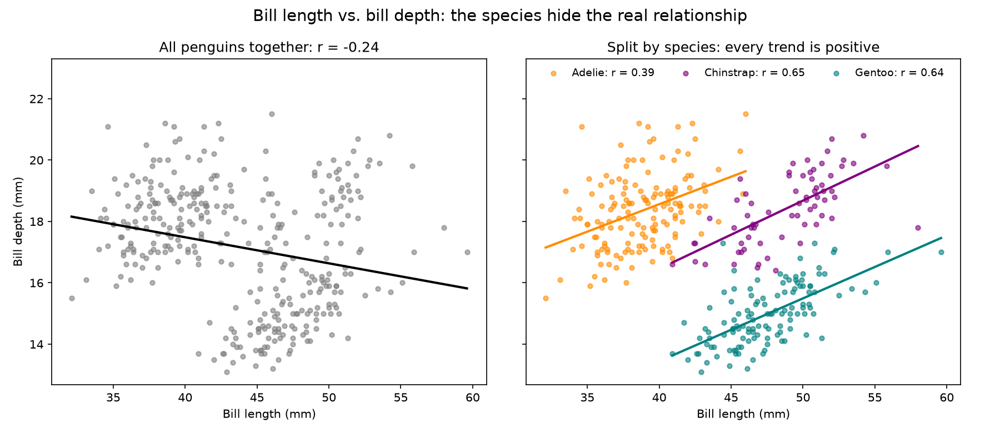

# Assignment 8: OOP and Basic Data Analysis

Questions 1 to 3 build classes: a `Person` with a raise method, and an
inheritance tree for a pizza shop. Question 4 analyzes the Palmer Penguins
dataset with pandas.

## Files

| File | What it holds |
|---|---|
| `q1_person.py` | Question 1: the `Person` class with `applyRaise`, plus a demo with checks |
| `q2_pizza_shop.py` | Question 2: the `Employee`, `Chef`, `PizzaRobot` and `Server` classes |
| `q3_test_pizza_shop.py` | Question 3: one instance of each class, with salary and inheritance tests |
| `q4_penguins.py` | Question 4: load, describe, summary statistics, covariance and correlation, the chart, takeaways |
| `penguins.csv` | The Palmer Penguins data: 344 penguins |
| `q4_bill_length_vs_depth.png` | Chart: bill length vs. bill depth, for all penguins and by species |
| `AI_COLLABORATION.md` | How GenAI was used, and who did what |

Each script's docstring explains its question; comments explain the code and
the printed output interprets the results.

## How to run

Python 3.11 or newer. Questions 1 to 3 use only the standard library.
Question 4 needs pandas, numpy and matplotlib, which are all in the repo's
`requirements.txt`. Tested with Python 3.14.6, pandas 3.0.3, numpy 2.4.6 and
matplotlib 3.11.0.

```
python q1_person.py
python q3_test_pizza_shop.py
python q4_penguins.py
```

`q2_pizza_shop.py` only defines the classes, so running it prints nothing;
`q3_test_pizza_shop.py` imports it. Keep all the files in one folder.

## The classes

### Person (Question 1)

| Attribute or method | Meaning |
|---|---|
| `name` | The person's name |
| `job` | Their job; optional, defaults to `None` |
| `pay` | Their pay; optional, defaults to `0` |
| `applyRaise(percent)` | Raises `pay` by `percent`, given as a whole number: `applyRaise(10)` is a 10% raise. The new pay is rounded to cents. |

### The pizza shop (Question 2)

| Class | Parent class | Salary | `work()` prints |
|---|---|---|---|
| `Employee` | none | optional, defaults to `None` | `<name> does stuff` |
| `Chef` | `Employee` | 50000 | `<name> makes food` |
| `PizzaRobot` | `Chef` | `None` (no salary) | `<name> makes pizza` |
| `Server` | `Employee` | 40000 | `<name> takes orders` |

- Every class is created with a `name`. `Chef` and `Server` pass their salary
  up to `Employee`'s constructor, so the code that stores a name and salary
  is written once.
- `PizzaRobot` runs `Chef`'s constructor, then sets its salary to `None`. The
  order matters: the other way round, `Chef`'s constructor would run last and
  put the 50000 back.
- Each subclass overrides `work()`, so the same call does something different
  for each kind of employee.
- `Employee.__repr__` prints any employee as
  `<ClassName: name=..., salary=...>`, using the class of the actual object.

### Tests (Question 3)

`q3_test_pizza_shop.py` makes one of each employee and runs 11 checks: the
five salaries (including an `Employee` with no salary and one given a salary),
that the robot doesn't keep `Chef`'s 50000, and that each object is an
instance of its parent classes. The first failed check stops the script with
an `AssertionError`. The script also prints the order in which Python searches
`PizzaRobot`'s classes for a method, and calls `work()` on every employee.

## Question 4: Palmer Penguins

**Data:** body measurements of 344 penguins of three species on three islands
near Palmer Station, Antarctica, 2007 to 2009. Collected by Dr. Kristen Gorman
with the Palmer Station LTER program and packaged as palmerpenguins by
Allison Horst, Alison Hill and Kristen Gorman
([allisonhorst.github.io/palmerpenguins](https://allisonhorst.github.io/palmerpenguins),
doi:10.5281/zenodo.3960218). License: CC-0. Two penguins have no measurements
and are dropped; 342 remain.

**Summary statistics** (standard deviation and variance are sample values,
n − 1, because these penguins stand in for their species):

| Statistic | Bill length (mm) | Bill depth (mm) | Flipper length (mm) | Body mass (g) |
|---|---|---|---|---|
| Mean | 43.92 | 17.15 | 200.92 | 4,201.75 |
| Median | 44.45 | 17.30 | 197.00 | 4,050.00 |
| Mode | 41.10 | 17.00 | 190.00 | 3,800.00 |
| Standard deviation | 5.46 | 1.97 | 14.06 | 801.95 |
| Variance | 29.81 | 3.90 | 197.73 | 643,131.08 |

**Covariance and correlation of bill length and bill depth:**

| Group | Penguins | Covariance (mm²) | Correlation |
|---|---|---|---|
| All penguins | 342 | −2.53 | −0.235 |
| Adelie | 151 | 1.27 | 0.391 |
| Chinstrap | 68 | 2.48 | 0.654 |
| Gentoo | 123 | 1.95 | 0.643 |

The relationship is negative for all penguins together and positive inside every species. That flip is called Simpson's paradox: Gentoo bills are long and shallow, Adelie bills short and deep, and pooling the species hides the trend inside each one.



**Takeaways, in my own words:**

1. The side-by-side bill chart is a great example of dual encoding: the
   scatter, the trend lines and the color, side by side. Looking at the whole
   population of penguins is misleading. Colored by species, the scatter
   begins to tell the whole story on its own, and the trend lines become
   self-evident.
2. Chinstrap matches up with Gentoo on bill length (48.8 mm vs. 47.5 mm), but
   otherwise Chinstrap and Adelie match up on bill depth, flipper length and
   body mass.
3. Look at specific species of penguins. It's hard to compare across penguin
   species.
4. The same whole-vs-part effect would likely show up at work: field
   operations broken out by region could tell a different story than the
   number for the whole country.

## Linting

From this folder, with the repo's `.pylintrc`:

```
pylint q1_person.py q2_pizza_shop.py q3_test_pizza_shop.py q4_penguins.py --rcfile=../../.pylintrc
```

Result: **10.00/10** with pylint 3.3.9 and 4.0.6. Two rules are switched off
where the assignment's own design conflicts with them, each with a comment
saying why: the `applyRaise` name (the assignment specifies camelCase), and
`too-few-public-methods` on classes the assignment defines with one method.

## AI use

GenAI was used with attribution, as the assignment allows. See
`AI_COLLABORATION.md` for how it was used and who did what.
