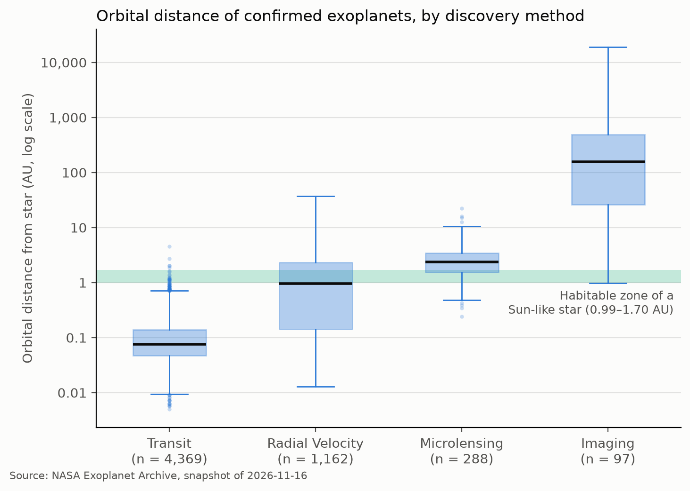

# Final Project Proposal

### 1. Dataset
**NASA Exoplanet Archive, Planetary Systems Composite Parameters table**: one row per confirmed
exoplanet, **6,470 planets** as of November 16, 2026. I'll pull it from the archive's public API
and commit a dated snapshot CSV so the analysis can be rerun.

I'll use the planets found by the four main discovery methods that have a recorded orbital
distance: **5,916 planets** (transit 4,369, radial velocity 1,162, microlensing 288, imaging 97).
The other seven methods have fewer than 30 planets each and are left out.

*Orbital distance = the planet's average distance from its star (semi-major axis), in AU; 1 AU is
the Earth–Sun distance. For planets found by microlensing or imaging, the archive records the
projected separation on the sky in this column instead.*

### 2. Hypothesis
*The habitable zone, or "Goldilocks zone," is the band of distances around a star where liquid
water could exist on a planet's surface.*

**Null:** For the confirmed exoplanets in NASA's Exoplanet Archive that orbit in their star's
habitable zone, there will be no difference between the discovery methods of planets around
small, cool stars and planets around Sun-like stars.

**Alternative:** For the confirmed exoplanets in NASA's Exoplanet Archive that orbit in their
star's habitable zone, there will be a difference in the discovery methods of planets around
small, cool stars and planets around Sun-like stars.

The zone sits close to a small, dim star and far from a large, bright one, so a fixed distance
like 1 AU only marks the zone for stars like the Sun. I expect the method that finds the most
zone planets to depend on the star: transit around small stars, where the zone is close in, and
radial velocity around Sun-like stars.

Each method can only detect planets in a certain range of distances. So if the alternative
holds, it says as much about how planets are found as about where they are.

### 3. Models
**Stage 1: Describe.**
- Count, median and interquartile range for each method. The distances are skewed, so the median
  describes them better than the mean.
- A log transform of orbital distance, since the values range from 0.005 to 19,000 AU.
- Planets found per year by each method, from the first in 1995 to today.

**Stage 2: Compare.**
- **Welch's one-way ANOVA** on log distance across the four methods, to confirm that each method
  looks at a different range of distances. Welch's version doesn't assume the groups have equal
  spread, which matters with groups of 97 to 4,369 planets. I'll report the **effect size (eta
  squared)**: the share of the variation in log distance that discovery method accounts for.

**Stage 3: Predict.**
- A **K-nearest neighbors classifier** that predicts a planet's discovery method from its orbital
  distance alone, with a train/test split and cross validation to choose k.
- The baseline is always guessing transit, which is right 74% of the time. I'll report precision,
  recall and F1 for each method, because accuracy alone hides how the small groups do.
- Then I'll add one feature, the system's distance from Earth, and compare. I expect orbital
  distance alone to confuse radial velocity with microlensing, and distance from Earth to
  separate them.

**Stage 4: The habitable zone.**
- Flag each planet as inside or outside its star's habitable zone (the "Goldilocks zone," where
  liquid water could exist on the surface), using the starlight the planet receives and the
  limits from Kopparapu et al. (2013). Microlensing planets drop out of this stage because their
  stars' brightness isn't recorded.
- **The hypothesis test:** a **chi-square test** on the planets in the zone, comparing discovery
  method (transit or radial velocity) across small, cool stars and Sun-like stars, grouped by
  the star's temperature. If any group is too small for chi-square, Fisher's exact test.
- The share of each method's planets that fall in the zone. Imaging has too few planets to
  compare and is reported as a count.
- Of the planets in the zone, the share small enough to be rocky (radius under 1.6 Earth radii,
  from Rogers 2015). Our own solar system has rocky planets close in and gas giants far out. If
  other systems formed the same way, most planets in the zone should be small enough to be
  rocky. Many radii in the archive are calculated rather than measured, so I'll flag which ones
  are.

*Limits: imaging and microlensing distances are projected separations, so they are measured
differently from the other two methods. Planets that share a star are not fully independent.
The archive holds the planets we have found, not all the planets that exist, so every count
here describes the catalog.*

### 4. Visual
**Box plot of orbital distance by discovery method, on a log scale, with the habitable zone of a
Sun-like star shaded.**

**Why it's useful:** the four groups span distances from a few thousandths of an AU to thousands
of AU. On a log scale all four fit on one chart, and each box shows a group's median and middle
half side by side. The shaded band shows where each method looks compared with the habitable
zone of a star like the Sun.

**What it shows:** each method finds planets in its own range. Transit is closest (median
0.08 AU), and more than 99% of its planets orbit closer to their star than Earth does to the
Sun. Radial velocity (median 0.97 AU) is the one method whose box spans the band. Microlensing
(median 2.4 AU) sits mostly just beyond it and imaging (median 156 AU) far beyond. The band moves inward for small, dim
stars, which is why the hypothesis groups stars by temperature.

*This research has made use of the NASA Exoplanet Archive, which is operated by the California
Institute of Technology, under contract with the National Aeronautics and Space Administration
under the Exoplanet Exploration Program.*

*AI use: see `AI_COLLABORATION.md`.*
